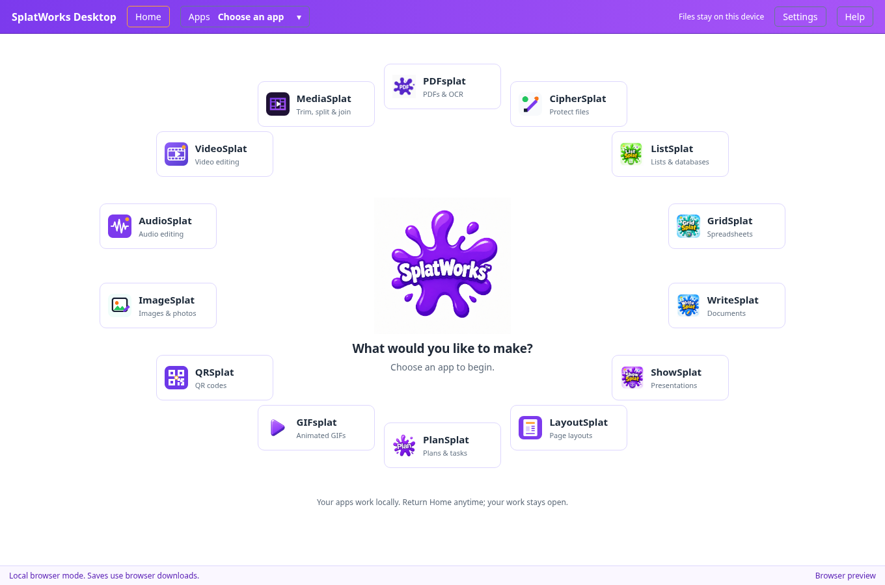

# SplatWorks Desktop

PDFsplat and CipherSplat in a local desktop application for Linux, Windows, and
macOS. Go and Wails provide the application shell and native file saving. The
existing SplatWorks web tools provide PDF rendering, editing, OCR, and encryption.

[Download releases](https://github.com/mguhlin/splatworks-desktop/releases) ·
[SplatWorks](https://splatworks.org) ·
[Browser-tool source](https://github.com/mguhlin/drawsplat)



## Install

Unsigned candidates have no verified publisher signature or Apple notarization.
Windows and macOS may show a publisher warning. Downloads include SHA-256
checksums. Stable releases require developer signing and physical-device
validation approval; see [Signing](docs/SIGNING.md) and [Validation](docs/VALIDATION.md).

- **Linux x86-64 (Debian 13 / Ubuntu 24.04 or newer):** use the `.deb`, or extract the `.tar.gz` and
  run `SplatWorks-Desktop`. Requires GTK 3 and WebKitGTK 4.1. The Debian package
  declares these dependencies so the package manager can install them.
- **Windows 11 x86-64:** run the `-setup.exe` installer. It installs for the current
  user, creates shortcuts and an uninstall entry, and includes Microsoft's full
  WebView2 runtime installer for machines that need it, including offline setup.
  The runtime publisher is verified before packaging. A portable ZIP is also
  available; that edition requires an existing WebView2 runtime.
- **Mac, Intel or Apple silicon:** open the DMG and copy `SplatWorks Desktop.app`
  to Applications, or extract the ZIP. The universal application contains both
  architectures. Uses the system WebKit runtime. The target support baseline is
  macOS 14 or newer; both architectures still need physical-device qualification.

Go, Node.js, and Python are not required to use the desktop application. The local
tools work without internet access once the platform runtimes are installed.
Website links open in the system browser. There is no updater or runtime tool
download.

## Use

Choose **PDFsplat** or **CipherSplat** in the application bar. Switching tools
keeps both workspaces open. Open a file with the tool's picker or drop it into the
workspace. Saves use native destination dialogs and report success after the write
completes. Tool tabs indicate unsaved work. The app warns before discarding it or
replacing an edited PDF and blocks closing during operations. CipherSplat restores folder
packages inside a newly created directory, preserving nested paths and empty
files without overlaying an existing folder. Close the application to discard
unsaved work and in-memory keys after confirmation. No automatic recovery copies
are written. Ctrl/Cmd+1 and Ctrl/Cmd+2 switch tools.

The complete PDF/OCR engines, English and Spanish OCR models, Argon2id engine,
OpenPGP engine, icons, and interface translations are bundled. CipherSplat retains
the existing CS4 `.csplat` format, including compatibility with PDFsplat.

PDF text replacement and covers are visual edits, not secure redaction. OCR
requires review and does not create tagged accessible PDFs. Browser-engine memory
limits and existing import/export limitations still apply. Capture and recording share the browser implementations; availability depends on
webview APIs, codecs, device permissions and hardware. Importing existing photos
works independently of those capture capabilities. WebDeck exports open in
a browser for presentation and printing. Google Drive integration is omitted from
the desktop interface.

## Smaller standalone apps

[Download GIFsplat, CipherSplat, QRSplat, ImageSplat, AudioSplat and VideoSplat](https://github.com/mguhlin/splatworks-desktop/releases/tag/tools-v1.0.0-rc.3). Each has its own executable, installer and icon, with native saves and unsaved-work protection. The GIF, QR and image editions omit PDF/OCR engines. These are 1.0 release candidates pending developer signing and physical validation. See [standalone scope and build instructions](docs/STANDALONE.md).

See the [1.0 release contract](docs/1.0.md) for feature scope and stable-publication requirements.

## Repository boundaries

This repository owns the shared Go shell, desktop adapters, installers, and
release workflows. `mguhlin/drawsplat` owns the browser applications and website.
The website can link to this repository's releases; GitHub Pages cannot run a
native desktop application. Other SplatWorks tools can join the registry as their
offline dependencies and desktop behavior are verified.

The tools are a committed, reproducible snapshot. `frontend/source-manifest.json`
records the upstream commit and bundled file hashes, without maintenance dates.
No symlink to another checkout or external server is needed to build a release.

## Develop

Install Go 1.27 or newer, Wails CLI **v2.17.1**, and the [Wails platform build dependencies](https://v2.wails.io/docs/gettingstarted/installation/).
On Linux, use GTK 3 and WebKitGTK 4.1 development packages. Node.js is needed only
for browser checks or rebuilding the upstream JavaScript bundle.

```sh
go install github.com/wailsapp/wails/v2/cmd/wails@v2.17.1
python3 scripts/check-assets.py
go test -race ./internal/transfer
wails build -tags webkit2_41      # Linux
# wails build                    # Windows or macOS
```

Use `wails dev -tags webkit2_41` on Linux, or `wails dev` elsewhere. A built
application also offers `--serve` for a loopback browser session with ordinary
browser downloads and no native file access. It prints its local address; use
`--port 4194` to select a fixed port.

```sh
npm ci
npx playwright install chromium webkit
npm test
./build/bin/SplatWorks-Desktop --smoke-test ./output/native
```

The explicit smoke-test option uses synthetic files and bypasses destination
dialogs. It runs the real desktop renderer, editing/export, chunked native saves,
CS4 authentication, folder restoration, and bundled OCR. `native-smoke.json`
contains the result. On Linux it can run under Xvfb with networking disabled.
The release workflow runs 23 native checks on each build platform, Go save/security
tests, and browser tests for lifecycle, save failure/cancellation and compatibility.
It also installs, upgrades and uninstalls the Windows setup package, installs and
removes the Linux package, and checks the Mac archive/DMG and both architectures.
These automated checks do not establish physical-device screen-reader, touch,
or actual file-picker behavior. See [Desktop security boundaries](SECURITY.md).

To import a reviewed browser-tools revision:

```sh
python3 scripts/sync-tools.py ../drawsplat_github
python3 scripts/check-assets.py
```

Make browser tool changes upstream first. Run `npm ci` here before syncing.
`sync-tools.py` imports the reviewed snapshot, applies the desktop-only lifecycle
and save integration through `scripts/adapt-tools.mjs`, and rebuilds the bundled
editor with the pinned upstream builder. Integration checks fail if expected
source hooks change. The browser repository remains unchanged by desktop imports.

## Licensing

AGPL-3.0-or-later, retaining the upstream SplatWorks license and notices. See
[LICENSE](LICENSE), [COPYING](COPYING), [NOTICE.md](NOTICE.md), and
[THIRD-PARTY-NOTICES.md](THIRD-PARTY-NOTICES.md). User documents and keys remain
their owners' content. This desktop edition is not an all-Go rewrite of the tools.
